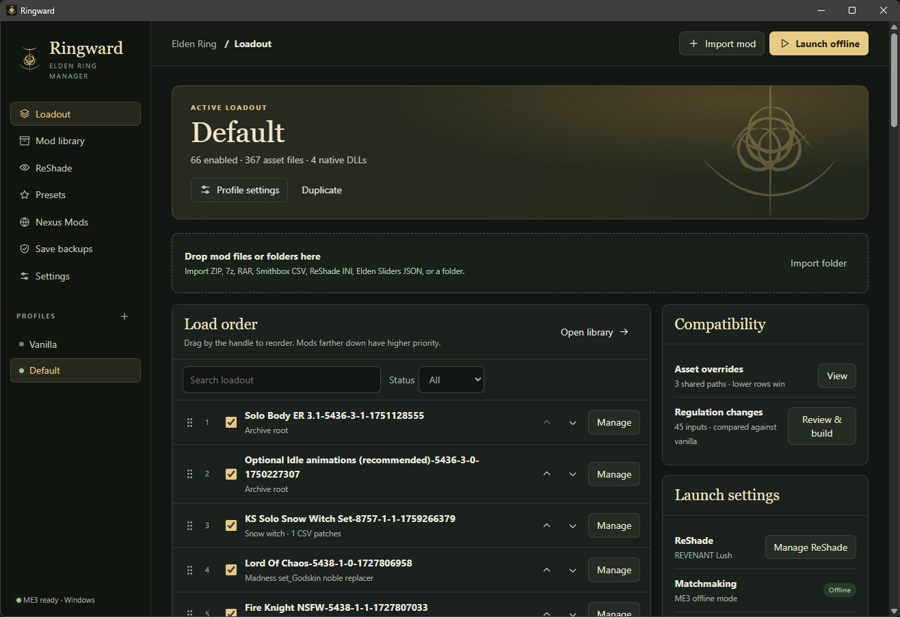
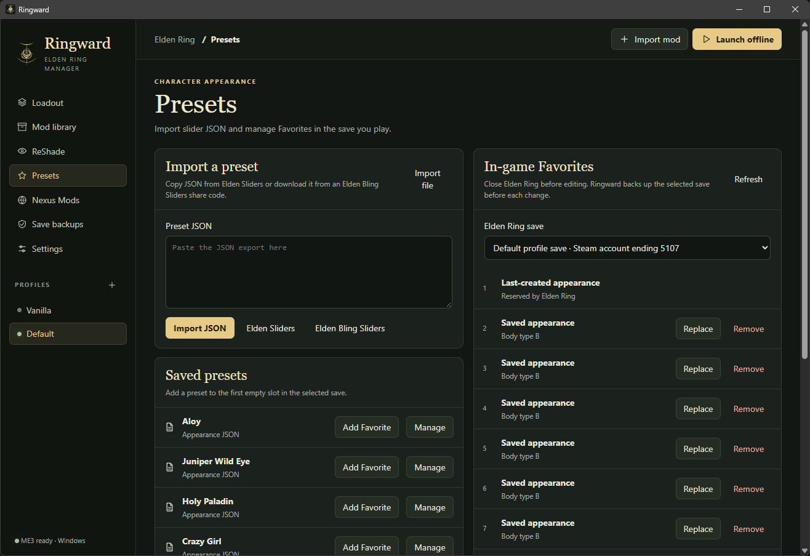
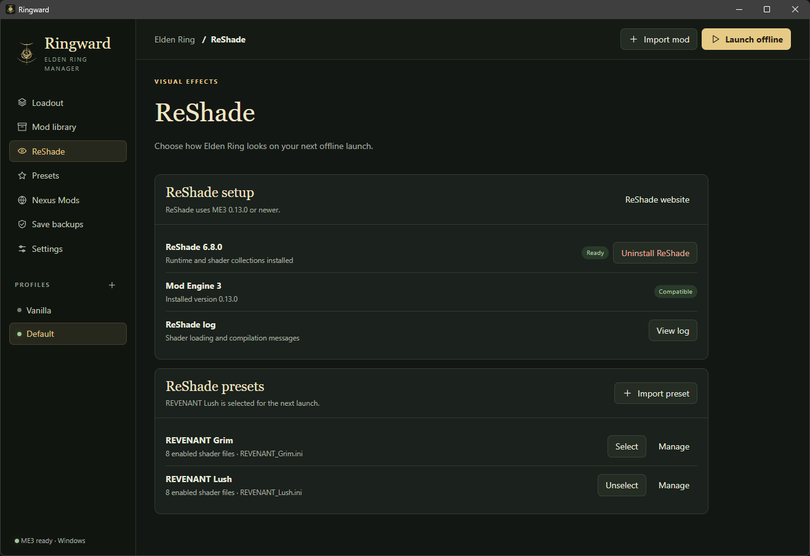
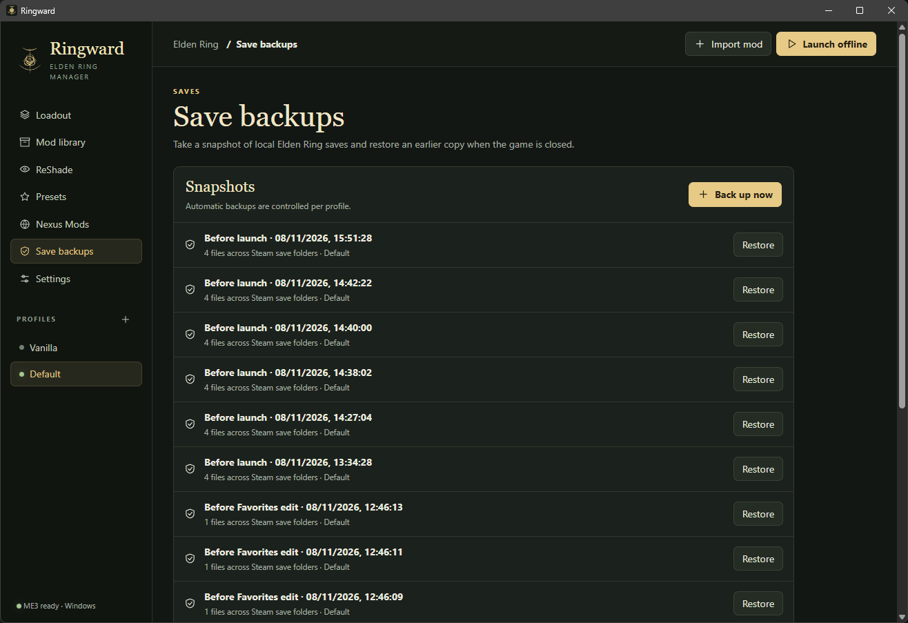

<p align="center"></p>

<h1 align="center">Ringward</h1>

<p align="center">An Elden Ring mod manager for Windows. Organize your loadout, review conflicts, and launch through Mod Engine 3.</p>

<p align="center">
  <a href="https://github.com/marlonmarcello/ringward/releases">Download for Windows</a>
  · <a href="#getting-started">Getting started</a>
  · <a href="CHANGELOG.md">Changelog</a>
</p>

<p align="center"></p>

## What Ringward does

| Feature | What you can do |
| --- | --- |
| **Profiles and load order** | Keep separate loadouts, drag mods to reorder them, and search or filter by enabled status. The built-in **Vanilla** profile is always available. |
| **Mod library** | Import ZIP, supported 7z or RAR archives, and extracted folders. Ringward detects asset roots, flags unknown layouts, and checks for duplicate files and content. |
| **Regulation automation** | Combine `regulation.bin` files and Smithbox CSV patches using Smithbox definitions. Review competing edits, then let load order resolve the approved conflicts. Build a standalone file or have Ringward build it at launch. |
| **Character presets** | Paste or import JSON from **Elden Sliders** and **Elden Bling Sliders**. Add, replace, or remove entries in the selected save’s in-game Favorites. Ringward backs up the save before each edit. |
| **Save backups** | Keep an isolated save per profile, take manual or automatic snapshots, and restore earlier saves. Ringward backs up any existing saves it replaces during a restore. |
| **ReShade** | Install the standard runtime and managed shader collections, then import a preset archive or INI. Presets are independent of gameplay profiles. Tutorial progress, overlay settings, and saved preset edits carry over between launches. |
| **Nexus Mods** | Look up mod files and import supported downloads through the Nexus API or `nxm://` links. The personal API key integration is available for testing in this development preview. |

## Getting started

1. Download the **Windows x64 ZIP** from [GitHub Releases](https://github.com/marlonmarcello/ringward/releases). Extract the whole ZIP into a folder and open **Ringward.exe**. The build is unsigned.
2. In **Settings → Game & loader**, confirm the Steam copy of Elden Ring. If ME3 is missing, choose **Install ME3** or point Ringward at an existing `me3.exe`.
3. Drop a mod archive or folder onto **Loadout**. Use **Manage** to choose an alternate asset root, configure DLLs, or select CSV patches. Mods farther down the load order have higher priority.
4. For mods with regulation edits, install **Smithbox** in Settings and select **Review & build**. Then choose **Launch offline** to start with your loadout.

For a standard Steam launch, choose **Vanilla** and unselect any active ReShade preset. **Settings → Game options → Startup logos** controls the logos for ME3 launches.

## Regulation merges

Ringward compares each mod’s regulation file against a vanilla baseline of the same version, then applies the differences to the installed game’s regulation. Independent edits combine. If two mods change the same field differently, Ringward shows the conflict before building and the later mod wins once you approve the load order.

A Smithbox CSV applies after that mod’s own binary regulation. Ringward identifies the target table from the filename or fields, with a manual table option for ambiguous files. Older binary regulations require their matching baseline. Incompatible edits are reported with the affected mod and table.

## Character presets, ReShade, and saves

| Character presets | ReShade | Save backups |
| --- | --- | --- |
|  |  |  |

- **Appearance.** Export JSON from [Elden Sliders](https://eldensliders.com/) or [Elden Bling Sliders](https://eldenblingsliders.com/), then import it under **Presets**. Close the game, select the PC save you play, and add the appearance to Favorites. Image-only slider guides can be viewed from the library and entered by hand.
- **ReShade.** Open **ReShade**, install the runtime, and select an imported preset. Ringward uses bundled shaders and textures and reports missing effects. **Uninstall ReShade** removes the managed runtime and shader collections while keeping your imported presets.
- **Saves.** Use **Save backups** for manual snapshots and restores. Use **Profile settings** to control automatic backups and isolated saves. Backups and the mod library live in Ringward’s app data.

Nexus Mods personal API keys are for testing and personal use. Local archive imports work independently of a Nexus account. [Nexus Mods API policy](https://help.nexusmods.com/article/114-api-acceptable-use-policy)

## Build from source

Use Windows x64, Node.js 24, and the .NET 10 SDK.

```powershell
npm ci
npm test
npm run build:merge
npm start
```

Run `npm run build:unpacked` to package the app into `release/win-unpacked`, or `npm run build` to create the installer. The merge build fetches pinned Smithbox reference assemblies. Set `SMITHBOX_DIR` to use an extracted Smithbox 2.2.6 release or `RINGWARD_DOTNET` to select a specific SDK executable.

### Publishing a release

GitHub Actions tests and builds pushes to `main` and pull requests. To release, update the version in `package.json` and its lockfile together, and add a matching version section to [CHANGELOG.md](CHANGELOG.md). Merge the changes, then create and push the matching `vX.Y.Z` tag from `main`. CI checks the version, builds the Windows ZIP, and publishes it with a SHA-256 checksum and the matching changelog entry. The 0.x builds are development previews.

## Credits

Ringward uses [Mod Engine 3](https://github.com/garyttierney/me3) for offline loading, [Smithbox](https://github.com/vawser/Smithbox) for regulation definitions and file libraries, and [ReShade](https://reshade.me/) for visual effects. [ME3 Manager](https://github.com/2Pz/me3-manager) informed the profile and library workflows.
